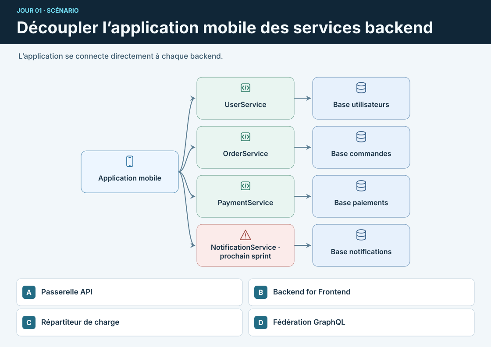

# System Design Questions

System Design Questions est un cahier interactif pour s’entraîner à la conception de systèmes. Il adapte les 60 scénarios de *60 Days of System Design Questions*, de Joud Awad, qui portent notamment sur les API, les bases de données, la fiabilité, le passage à l’échelle et les agents IA.

Chaque question propose quatre choix et une correction qui explique les compromis. La correction reste masquée jusqu’à la validation d’un choix ou au clic sur **Afficher la réponse**. Une première réponse correcte vaut un point, et la progression est conservée dans le navigateur.

Le cahier est disponible en anglais et en français. Le glossaire explique les termes techniques au survol ou au toucher. Les schémas SVG s’affichent dans la langue choisie et peuvent être agrandis dans la page. La traduction intégrale du livre est également disponible.

## Exemple

Au jour 01, une application mobile appelle directement trois services backend. Un quatrième arrive au prochain sprint. Comment ajouter ce service en réduisant le couplage avec le client mobile ? Comparez la passerelle API, le BFF, le répartiteur de charge et la fédération GraphQL. Validez votre choix pour voir le raisonnement de l’auteur et l’effet de votre réponse sur le score. [Essayer la question du jour 01](https://issamwebdeveloper.github.io/SystemDesignQuestions/#jour-01)

## Ouvrir le cahier

Après publication, le cahier et la traduction seront accessibles depuis GitHub Pages. [Ouvrir System Design Questions](https://issamwebdeveloper.github.io/SystemDesignQuestions/) · [Lire la traduction intégrale](https://issamwebdeveloper.github.io/SystemDesignQuestions/traduction-fr.html)

En local, ouvrez `dist/index.html` dans votre navigateur. Le dossier `dist/` contient le site statique et ses ressources. Aucune compilation n’est nécessaire.

## Publier sur GitHub Pages

1. Fusionnez la pull request dans la branche `main`.
2. Dans **Settings → General**, renommez le dépôt `SDQ` en `SystemDesignQuestions`. GitHub Pages utilise le nom du dépôt dans l’adresse d’un site de projet. [Renommer un dépôt](https://docs.github.com/en/repositories/creating-and-managing-repositories/renaming-a-repository) · [Adresses des sites GitHub Pages](https://docs.github.com/en/pages/getting-started-with-github-pages/what-is-github-pages)
3. Dans **Settings → Pages → Build and deployment → Source**, sélectionnez **GitHub Actions**. [Configurer la source de publication](https://docs.github.com/en/pages/getting-started-with-github-pages/configuring-a-publishing-source-for-your-github-pages-site)
4. Dans **Actions → Deploy to GitHub Pages**, sélectionnez **Run workflow**, choisissez `main` et lancez le déploiement. Le workflow publie le dossier `dist/`. Répétez cette étape pour publier les mises à jour. [Lancer un workflow manuellement](https://docs.github.com/en/actions/how-tos/manage-workflow-runs/manually-run-a-workflow)
5. Quand l’exécution réussit, ouvrez le site depuis **Settings → Pages**. [Ouvrir le site publié](https://issamwebdeveloper.github.io/SystemDesignQuestions/)

## Index des 60 questions

Les liens de cet index seront actifs après la publication du site sur GitHub Pages.

| Jour | Question |
| --- | --- |
| 01 | [Découpler l’application mobile des services backend](https://issamwebdeveloper.github.io/SystemDesignQuestions/#jour-01) |
| 02 | [Éliminer le problème des requêtes N+1](https://issamwebdeveloper.github.io/SystemDesignQuestions/#jour-02) |
| 03 | [Limiter le débit sans rafales aux changements de fenêtre](https://issamwebdeveloper.github.io/SystemDesignQuestions/#jour-03) |
| 04 | [Éviter les doubles prélèvements](https://issamwebdeveloper.github.io/SystemDesignQuestions/#jour-04) |
| 05 | [Choisir une stratégie de sharding pour une base de données](https://issamwebdeveloper.github.io/SystemDesignQuestions/#jour-05) |
| 06 | [Sécuriser les verrous distribués des tâches cron](https://issamwebdeveloper.github.io/SystemDesignQuestions/#jour-06) |
| 07 | [Garantir l’ordre des événements dans une file de messages](https://issamwebdeveloper.github.io/SystemDesignQuestions/#jour-07) |
| 08 | [Synchroniser le cache et la base de données](https://issamwebdeveloper.github.io/SystemDesignQuestions/#jour-08) |
| 09 | [Séparer les modèles de lecture et d’écriture](https://issamwebdeveloper.github.io/SystemDesignQuestions/#jour-09) |
| 10 | [Gérer les transactions distribuées entre services](https://issamwebdeveloper.github.io/SystemDesignQuestions/#jour-10) |
| 11 | [Traiter les nouvelles tentatives de webhook de façon idempotente](https://issamwebdeveloper.github.io/SystemDesignQuestions/#jour-11) |
| 12 | [Indexer une table qui reçoit beaucoup d’écritures](https://issamwebdeveloper.github.io/SystemDesignQuestions/#jour-12) |
| 13 | [Gérer un pool de connexions partagé](https://issamwebdeveloper.github.io/SystemDesignQuestions/#jour-13) |
| 14 | [Déployer un changement risqué en toute sécurité](https://issamwebdeveloper.github.io/SystemDesignQuestions/#jour-14) |
| 15 | [Vérifier rapidement si l’utilisateur a déjà vu un contenu](https://issamwebdeveloper.github.io/SystemDesignQuestions/#jour-15) |
| 16 | [Soulager une clé de partition trop sollicitée](https://issamwebdeveloper.github.io/SystemDesignQuestions/#jour-16) |
| 17 | [Appliquer la contre-pression à un consommateur saturé](https://issamwebdeveloper.github.io/SystemDesignQuestions/#jour-17) |
| 18 | [Éviter une ruée sur le cache](https://issamwebdeveloper.github.io/SystemDesignQuestions/#jour-18) |
| 19 | [Relire ses propres écritures avec des répliques de lecture](https://issamwebdeveloper.github.io/SystemDesignQuestions/#jour-19) |
| 20 | [Isoler une dépendance aval en panne](https://issamwebdeveloper.github.io/SystemDesignQuestions/#jour-20) |
| 21 | [Choisir un transport de streaming en temps réel](https://issamwebdeveloper.github.io/SystemDesignQuestions/#jour-21) |
| 22 | [Fiabiliser la messagerie entre services](https://issamwebdeveloper.github.io/SystemDesignQuestions/#jour-22) |
| 23 | [Diffuser les publications des comptes très suivis dans les fils d’actualité](https://issamwebdeveloper.github.io/SystemDesignQuestions/#jour-23) |
| 24 | [Paginer efficacement des résultats volumineux](https://issamwebdeveloper.github.io/SystemDesignQuestions/#jour-24) |
| 25 | [Gérer la contre-pression d’une file lors d’un pic de trafic](https://issamwebdeveloper.github.io/SystemDesignQuestions/#jour-25) |
| 26 | [Préserver la cohérence du cache lors des écritures](https://issamwebdeveloper.github.io/SystemDesignQuestions/#jour-26) |
| 27 | [Maintenir à jour les réponses d’un LLM](https://issamwebdeveloper.github.io/SystemDesignQuestions/#jour-27) |
| 28 | [Choisir une base vectorielle pour la recherche sémantique](https://issamwebdeveloper.github.io/SystemDesignQuestions/#jour-28) |
| 29 | [Orchestrer un workflow multi-agent](https://issamwebdeveloper.github.io/SystemDesignQuestions/#jour-29) |
| 30 | [Choisir une solution de stockage de fichiers](https://issamwebdeveloper.github.io/SystemDesignQuestions/#jour-30) |
| 31 | [Réduire la latence entre régions](https://issamwebdeveloper.github.io/SystemDesignQuestions/#jour-31) |
| 32 | [Gérer les secrets et les identifiants](https://issamwebdeveloper.github.io/SystemDesignQuestions/#jour-32) |
| 33 | [Reconstruire l’état avec l’event sourcing](https://issamwebdeveloper.github.io/SystemDesignQuestions/#jour-33) |
| 34 | [Améliorer la précision de classification d’un LLM](https://issamwebdeveloper.github.io/SystemDesignQuestions/#jour-34) |
| 35 | [Trouver les chauffeurs à proximité à grande échelle](https://issamwebdeveloper.github.io/SystemDesignQuestions/#jour-35) |
| 36 | [Choisir entre HTTP/3 et HTTP/2 à l’edge](https://issamwebdeveloper.github.io/SystemDesignQuestions/#jour-36) |
| 37 | [Résoudre les conflits d’écriture en édition collaborative](https://issamwebdeveloper.github.io/SystemDesignQuestions/#jour-37) |
| 38 | [Traiter un long document avec un LLM](https://issamwebdeveloper.github.io/SystemDesignQuestions/#jour-38) |
| 39 | [Empêcher deux opérations concurrentes de dépasser un solde](https://issamwebdeveloper.github.io/SystemDesignQuestions/#jour-39) |
| 40 | [Déporter un traitement lourd hors du thread principal](https://issamwebdeveloper.github.io/SystemDesignQuestions/#jour-40) |
| 41 | [Passer du traitement par lots au streaming en temps réel](https://issamwebdeveloper.github.io/SystemDesignQuestions/#jour-41) |
| 42 | [Concevoir la mémoire d’un agent IA](https://issamwebdeveloper.github.io/SystemDesignQuestions/#jour-42) |
| 43 | [Invalider le cache du CDN à chaque déploiement](https://issamwebdeveloper.github.io/SystemDesignQuestions/#jour-43) |
| 44 | [Synchroniser les modifications hors ligne sans perdre de données](https://issamwebdeveloper.github.io/SystemDesignQuestions/#jour-44) |
| 45 | [Mettre à l’échelle la recherche plein texte](https://issamwebdeveloper.github.io/SystemDesignQuestions/#jour-45) |
| 46 | [Imposer des sorties structurées à un LLM](https://issamwebdeveloper.github.io/SystemDesignQuestions/#jour-46) |
| 47 | [Remplacer progressivement un monolithe avec le patron Strangler Fig](https://issamwebdeveloper.github.io/SystemDesignQuestions/#jour-47) |
| 48 | [Comment un agent choisit les outils à appeler](https://issamwebdeveloper.github.io/SystemDesignQuestions/#jour-48) |
| 49 | [Maîtriser le coût des requêtes dans un entrepôt de données](https://issamwebdeveloper.github.io/SystemDesignQuestions/#jour-49) |
| 50 | [Servir des modèles de ML à haut débit](https://issamwebdeveloper.github.io/SystemDesignQuestions/#jour-50) |
| 51 | [Isoler les clients qui monopolisent les ressources d’un SaaS multitenant](https://issamwebdeveloper.github.io/SystemDesignQuestions/#jour-51) |
| 52 | [Versionner une API sans casser les intégrations clientes](https://issamwebdeveloper.github.io/SystemDesignQuestions/#jour-52) |
| 53 | [Migrer un schéma sans interruption de service](https://issamwebdeveloper.github.io/SystemDesignQuestions/#jour-53) |
| 54 | [Gérer la dérive des embeddings dans un système RAG](https://issamwebdeveloper.github.io/SystemDesignQuestions/#jour-54) |
| 55 | [Exécuter des agents en parallèle avec un état partagé](https://issamwebdeveloper.github.io/SystemDesignQuestions/#jour-55) |
| 56 | [Suivre les tâches asynchrones de longue durée](https://issamwebdeveloper.github.io/SystemDesignQuestions/#jour-56) |
| 57 | [Garantir la cohérence à la lecture d’une confirmation de paiement](https://issamwebdeveloper.github.io/SystemDesignQuestions/#jour-57) |
| 58 | [Observer les workflows d’agents LLM](https://issamwebdeveloper.github.io/SystemDesignQuestions/#jour-58) |
| 59 | [Concevoir des clés d’idempotence pour les paiements](https://issamwebdeveloper.github.io/SystemDesignQuestions/#jour-59) |
| 60 | [Concevoir l’architecture d’une plateforme SaaS à partir de zéro](https://issamwebdeveloper.github.io/SystemDesignQuestions/#jour-60) |
